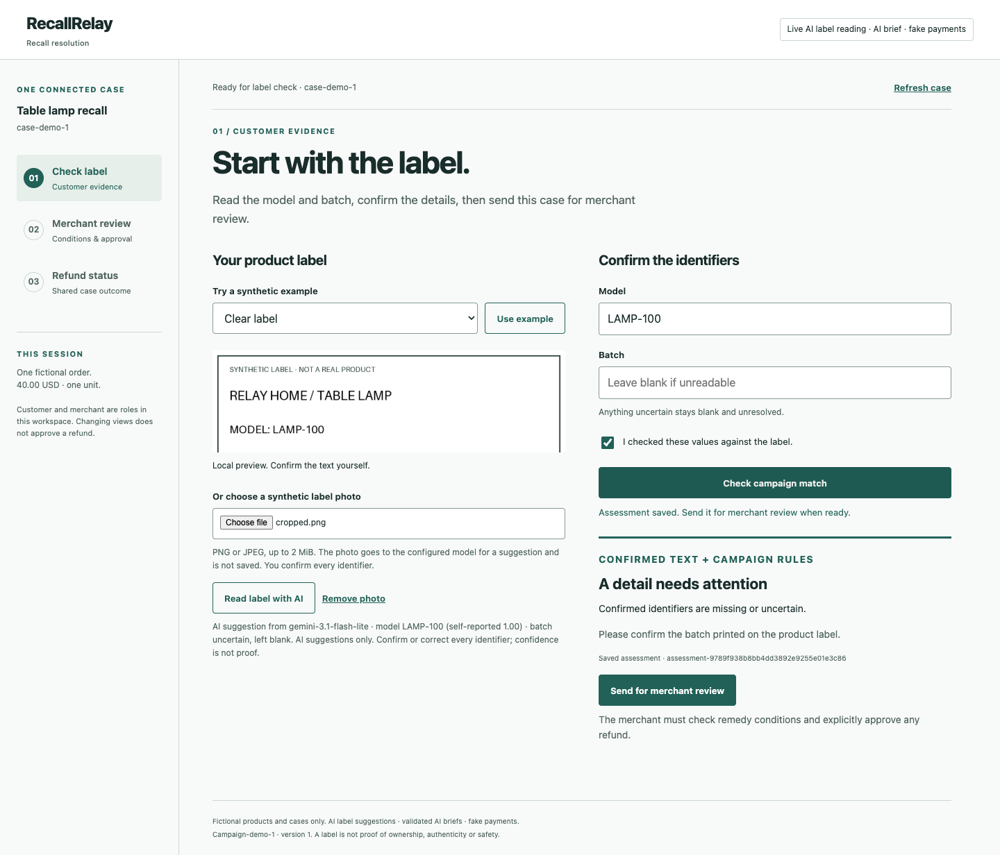
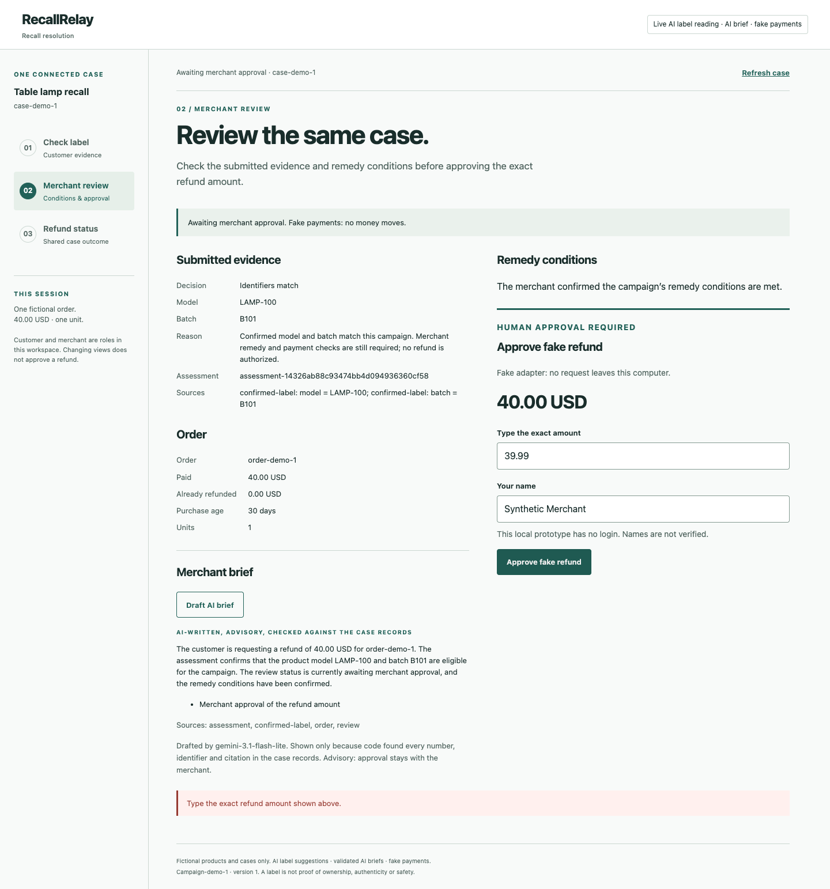
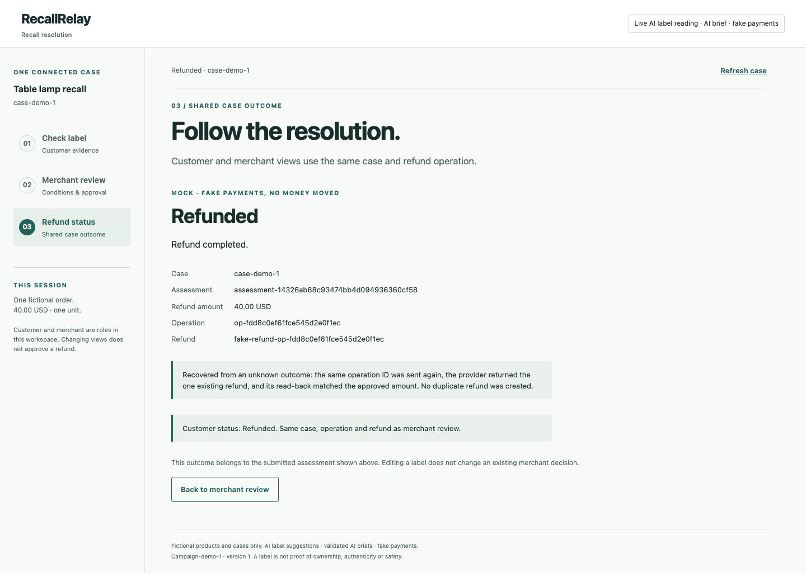
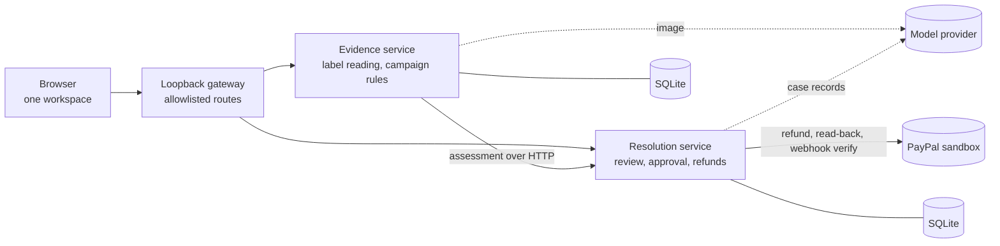

# RecallRelay

**Recall refunds that admit uncertainty and survive a lost payment response.**

[](https://github.com/RajivRanganath/recallrelay/actions/workflows/evidence.yml)
[](https://github.com/RajivRanganath/recallrelay/actions/workflows/resolution.yml)
[](https://github.com/RajivRanganath/recallrelay/actions/workflows/contracts.yml)
[](LICENSE)

When a product is recalled, a merchant has to answer one question per customer: *is this unit affected, and was it refunded exactly once?* The evidence is a label photo that may be blurred or cropped. The refund call can time out after the money already moved. RecallRelay is a working prototype built around those two failure points.

<!-- Demo video: add the YouTube link here before submission. -->

| | |
|---|---|
| **Who it is for** | A merchant's support or operations person running a recall, and the customer checking whether their unit is covered |
| **AI** | Reads label photos into identifiers and drafts the merchant's case brief. It proposes; it never decides or pays |
| **PayPal** | Sandbox refunds with idempotent retries, pre-approval payment checks, read-back and verified webhooks |
| **Try it** | [One command, no account](#try-it-in-two-minutes) |
| **Status** | Hackathon prototype. Sandbox only: no live money, no real customer data |

## Why it is different

- **Uncertain evidence is a result, not an error.** An unreadable or conflicting label never becomes eligible. The screen shows what was uncertain and what was asked.
- **An unknown payment outcome is neither success nor failure.** The operation ID is saved before PayPal is called and is reused as `PayPal-Request-Id`, so a retry cannot knowingly create a second refund.
- **Events are hints, not truth.** A verified PayPal webhook settles a case only after PayPal's own read-back matches the stored operation, amount, currency and `custom_id`. A replayed event changes nothing.
- **AI has no authority.** It proposes identifiers and prose. Rules decide eligibility; a person approves; code moves money.

## How it works

One workspace follows a single case through three steps.

### 1. Check the label

The customer uploads a label photo. A model proposes the model and batch identifiers. Anything it cannot read is left blank and the app asks one targeted question instead of guessing. The customer confirms every identifier, and deterministic campaign rules decide the outcome.



### 2. Merchant review

The same case opens for the merchant. A model drafts a short brief, and code shows it only if every number, identifier and citation appears in the case records. The merchant confirms the remedy conditions and types the exact refund amount; any other amount is refused.



### 3. Refund status

The refund is sent with a stored operation ID. If the response is lost, the case stays pending and nothing is retried automatically. Checking again sends the same operation ID, so the provider returns the one existing refund. Customer and merchant read the same case.



Screenshots are from a run on 12 November 2026 with real model calls (`gemini-3.1-flash-lite`) and fake payments, as the header chip states.

## Try it in two minutes

No account or key is needed. Python 3.11, macOS or Linux:

```sh
git clone https://github.com/RajivRanganath/recallrelay.git
cd recallrelay
python3 -m venv evidence/.venv
evidence/.venv/bin/python -m pip install -r evidence/requirements.lock.txt
evidence/.venv/bin/python -B -m evidence.integrated --port 0 --lose-first-refund-response
```

Windows PowerShell:

```powershell
py -3.11 -m venv evidence/.venv
.\evidence\.venv\Scripts\python.exe -m pip install -r evidence/requirements.lock.txt
.\evidence\.venv\Scripts\python.exe -B -m evidence.integrated --port 0 --lose-first-refund-response
```

Open the printed URL and follow **Check label → Merchant review → Refund status**:

1. Choose **Use example**, tick the confirmation and **Check campaign match**. Try the *Unreadable batch* and *Excluded batch* examples too.
2. **Send for merchant review**, generate the brief, confirm the remedy conditions.
3. Type `39.99` to see it refused, then `40.00` and a name, and approve.
4. The refund shows **Refund pending**, because this launch deliberately discards the first acknowledgement. Choose **Check pending refund again** to see it recover with the same operation ID.

This default run uses mock label reading, template briefs and fake payments, and says so on screen. Ctrl+C stops everything and removes the temporary data.

## Run it live

The same workspace runs with real model calls and PayPal **sandbox** refunds:

```sh
evidence/.venv/bin/python -B -m evidence.integrated --port 8101 \
  --extractor omniroute --brief omniroute --omniroute-env PATH/omniroute.env --model gemini/gemini-3.1-flash-lite \
  --paypal sandbox --paypal-env PATH/paypal.env --sandbox-case PATH/sandbox-case.json \
  --lose-first-refund-response
```

You need your own PayPal sandbox app and a model provider. Setup, the one-command sandbox payment and the measured runs are in the [live workspace guide](docs/evidence/LIVE-WORKSPACE.md).

## How AI and PayPal are used

| | What it does | What keeps it safe |
|---|---|---|
| **AI: label reading** | Image to model and batch identifiers with self-reported confidence | Low confidence or conflict leaves the field blank; text printed on a label is data, never instructions; the customer confirms |
| **AI: merchant brief** | Short grounded summary with citations and next steps | Code checks every number, identifier and citation against the records, or shows a template and says why |
| **PayPal: before approval** | Reads the capture, its order's refund history and disputes | Anything unclear blocks approval or sends the case to manual handling |
| **PayPal: refund** | Payments v2 capture refund with `PayPal-Request-Id` and `custom_id` | One operation ID per approved assessment, capture and amount; read-back before "refunded" |
| **PayPal: webhooks** | `PAYMENT.CAPTURE.REFUNDED` with signature verification | Verified by PayPal's API, then confirmed by read-back; replays are no-ops |

## What was measured

| Check | Result | Record |
|---|---|---|
| Real sandbox lost-response recovery | One 20.00 USD refund, acknowledgement deliberately lost, settled by a genuine verified webhook; the replay changed nothing | [Webhook results](docs/WEBHOOK-RESULTS.md) |
| Real sandbox idempotent retry | Two experiments: the same request ID returned the same refund both times | [Merchant runbook](docs/resolution/RUNBOOK.md) |
| Unified workspace against the real PayPal sandbox | One 40.00 USD refund: acknowledgement deliberately discarded, case held pending, then recovered with the same operation ID. PayPal shows exactly one refund on the capture | [Live workspace](docs/evidence/LIVE-WORKSPACE.md) |
| Unified workspace with a real model | Five labels and one brief in one session: three uncertain labels left unresolved, one excluded, one matched and refunded through the recovery path (fake payments) | [Live workspace](docs/evidence/LIVE-WORKSPACE.md) |
| Label reading on 12 development images | 24 of 24 fields agreed with authored references | [Evaluation results](docs/evidence/EVALUATION-RESULTS.md) |
| Label reading on 12 unseen images (new fonts, layouts, damage; references frozen before the run) | 11 of 12 calls returned; 20 of 22 fields agreed; no unaffected unit became eligible. One unreadable image got invented identifiers, and one call timed out | [Evaluation results](docs/evidence/EVALUATION-RESULTS.md) |
| One participant, typed versus AI-assisted | Median 8.03 s typed, 4.88 s assisted; two of twelve cases were slower with AI | [Evaluation results](docs/evidence/EVALUATION-RESULTS.md) |
| Merchant brief on 14 invented cases, 4 with prompt injection | 12 of 14 model drafts passed the checker; 2 were replaced by the template | [Merchant runbook](docs/resolution/RUNBOOK.md) |
| Automated tests, 12 November 2026, macOS | 173 customer-side, 169 merchant-side, 3 contract, 19 UI: all passed | [Development guide](docs/DEVELOPMENT.md) |

## How it is built



Two Python services with separate stores and dependencies, joined by a [frozen JSON contract](contracts/README.md). Standard-library HTTP servers, SQLite, plain HTML, CSS and JavaScript; no framework and no build step.

## Limits

- **Prototype scope.** Synthetic labels, one fictional campaign and order, PayPal sandbox funds, run locally without login. A label match is not proof of ownership or safety.
- **Small evidence base.** The measurements above cover 24 synthetic labels, 14 invented cases and one internal tester, with no merchant pilot. They support no general accuracy, time-saving or exactly-once claim. On one unreadable image the model invented identifiers; customer confirmation and the campaign rules, not the model, are what stand between that and a refund.

## More

[Documentation index](docs/README.md) · [Development guide and tests](docs/DEVELOPMENT.md) · [API contract](contracts/README.md)

## License

[MIT](LICENSE)
